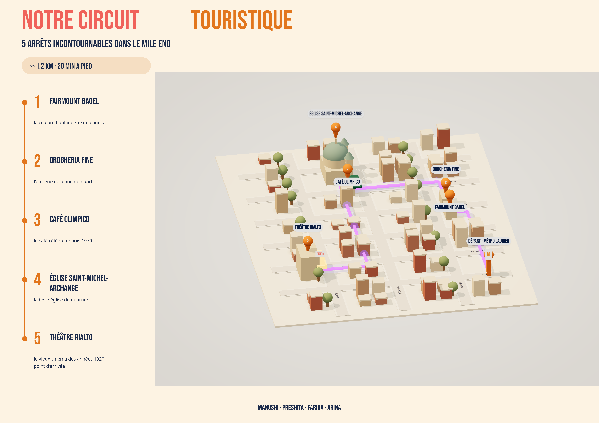

# Polish pass for map3d.js / map-render.html (must truly amaze) + route video slot
Review feedback on current render (4961x3508):
1. Labels far too small and pin 4 (Église) label missing; pins 1 and 2 overlap. Make label sprites large, bold Bebas Neue, navy text on white rounded "pill" cards with orange number circle, soft shadow, always facing camera, offset/leader lines so none overlap (1 and 2 placed on opposite sides). Every pin labelled: "1 FAIRMOUNT BAGEL", "2 DROGHERIA FINE", "3 CAFÉ OLIMPICO", "4 ÉGLISE SAINT-MICHEL-ARCHANGE", "5 THÉÂTRE RIALTO", start "DÉPART · MÉTRO LAURIER".
2. Path must glow: bright #5b2cff core tube + wide soft bloom (use EffectComposer UnrealBloomPass from three/examples/jsm postprocessing, selective by layers or low threshold), plus animated dashes/light pulse; route order Laurier -> 1 -> 2 -> 3 -> 4 -> 5 along the roads, ending at Rialto.
3. Camera: lower, more cinematic isometric (elevation ~30°), frame the route tightly so the map fills ~80% of the frame; slight tilt-shift (depth blur top/bottom via a simple shader pass or gradient overlay) and soft vignette.
4. Lighting & materials: warm golden-hour directional light with soft shadows (PCFSoftShadowMap, shadow map 4096 for render), ambient occlusion feel (contact shadows under buildings), buildings with roofs slightly lighter, a few trees (low-poly spheres on cylinders) along streets, landmarks detailed: church with green copper dome + 2 towers + cross; Rialto with lit marquee (emissive) and "RIALTO" sign; Fairmount Bagel small shop with sign; Olimpico with awning; Laurier metro orange "M" totem. Ground: cream base with roads light grey and white sidewalk edges; street name labels readable and aligned to roads.
5. Render page composition: her style (coral/orange title, navy subtitle), a left-side legend timeline like her Canva (orange dots line, numbers 1-5 in big orange, names in navy + one-line descriptions from her deck: "la célèbre boulangerie de bagels", "l'épicerie italienne du quartier", "le café célèbre depuis 1970", "la belle église du quartier", "le vieux cinéma des années 1920, point d'arrivée"), "≈ 1,2 km · 20 min à pied" chip, team credit footer. Supersample: render scene at 4961x3508 directly.
6. Website route section: add a toggle "Carte 3D | Vidéo" over a media area: (a) interactive 3D map (existing lazy mount), (b) <video muted loop autoplay playsinline preload="none" poster="map-3d.png" src="img/route-walk.mp4"> whose fallback is ; if the video errors (file absent), show the poster image. Default tab: 3D map if WebGL works, else image. Copy nothing; map-3d.png will be placed at site root by us.
Keep interactive mode fast (bloom at half res, shadows 1024, dpr<=2). Edit only map3d.js, map-render.html, index.html.
